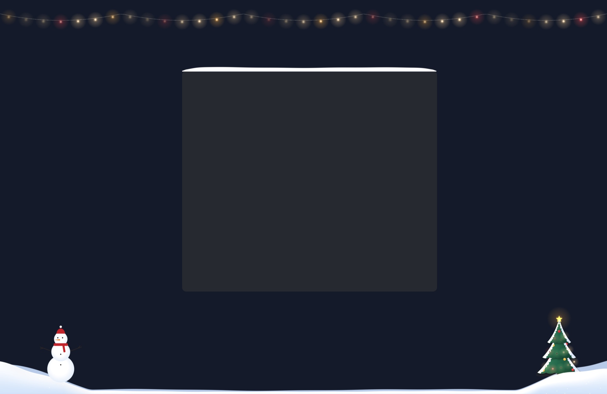

# Sugrob

**Тихая зима на вашем Mac.** Сугробы, которые порывами трогает ветер, тонкая тёплая гирлянда под строкой меню, заснеженная ёлка и счётчик дней до Нового года. Коснитесь ёлки курсором, и снег осыплется, а потом нарастёт снова. А в полночь 1 января будет салют.

Бесплатно, с открытым кодом (MIT). Без сети, без сбора данных и без системных разрешений. Около 2 МБ.



## Установка

```bash
curl -fsSL https://raw.githubusercontent.com/akoody/sugrob/main/install.sh | bash
```

Или скачайте [Sugrob.dmg](https://github.com/akoody/sugrob/releases/latest/download/Sugrob.dmg) и перетащите приложение в «Программы». Сборка пока не заверена Apple, поэтому при первом запуске откройте **Системные настройки → Конфиденциальность и безопасность → Всё равно открыть**.

Нужна macOS 13 или новее, Apple Silicon или Intel.

## Управление

Снежинка в строке меню открывает настройки, правый щелчок по ней включает и выключает снег.

| Клавиши | Действие |
|---|---|
| `⌃⌥D` | Включить или выключить снег |
| `⌃⌥S` | Лепить снеговика и играть в снежки |
| `1` `2` | Снежки, снеговик (в режиме игры) |
| `Esc` | Выйти из игры |

Чтобы слепить снеговика, катайте комья по снегу и кладите один на другой. На третьем коме снеговик сам получит глаза, нос, шарф, руки и шапку.

Вне игры все клики проходят сквозь снег.

## Бережно к Mac

Sugrob устроен как картина, а не как видео: пока ничего не происходит, он не рисует ни одного кадра.

- В покое сугробы и ёлка неподвижны, отрисовка остановлена. Гирлянду и огни ёлки анимирует сама macOS, приложение при этом спит.
- Раз в 25-50 секунд налетает порыв ветра на несколько секунд: гребни смещаются, летит снежная пыль. Потом снова тишина.
- Кадры появляются, только когда курсор касается снега или ёлки, двигается окно, идёт игра или салют.
- За окнами приложение следит по событиям, а не постоянно.
- Когда Mac занят тяжёлой задачей, ветер ждёт. На экране блокировки, в полноэкранных приложениях и при спящем экране всё остановлено.
- Через 5 минут без действий замирают и огни.
- В настройках видно, сколько секунд процессора Sugrob потратил за сегодня и сколько занимает прямо сейчас.

## Как устроено

Swift, AppKit и Metal, без сторонних зависимостей и без картинок в сборке: все спрайты и иконка рисуются кодом при запуске.

- `World`, `Surface`: физика снега. Сугроб хранится как одномерный профиль высоты на краю экрана или окна, ветер переносит снег вдоль него.
- `Coordinator`: решает, нужен ли следующий кадр. Если ничего не движется, сцена остаётся неподвижной картинкой и кадры не рисуются.
- `Renderer`, `Shaders`, `Atlas`: отрисовка через Metal, спрайты в одном атласе, рисуемом при старте.
- `WindowTracker`: читает только геометрию окон, без заголовков и содержимого, поэтому macOS не просит разрешений.
- `Play`: снежки и снеговик. `Sound` синтезирует звуки один раз и не держит аудиосессию открытой.
- `SelfTest`: проверки физики и игровой логики, запускаются в CI.

## Сборка

```bash
./scripts/build_app.sh
```

Нужны только Xcode Command Line Tools. Проверка логики: `Sugrob --selftest`. Новая версия выпускается тегом `v1.2.3`, GitHub Actions соберёт и опубликует релиз.

---

## English

**A quiet winter for your Mac.** Living drifts stirred by the wind, a thin warm garland under the menu bar, a snow-covered tree you can shake with the cursor and a countdown to New Year, with fireworks at midnight on January 1. Free and open source (MIT), about 2 MB, no network access and no system permissions.

```bash
curl -fsSL https://raw.githubusercontent.com/akoody/sugrob/main/install.sh | bash
```

`⌃⌥D` toggles the snow and `⌃⌥S` starts building a snowman. Roll balls through snow and stack three. Builds are not yet notarized, so the first launch needs **System Settings → Privacy & Security → Open Anyway**. Requires macOS 13 or later.
